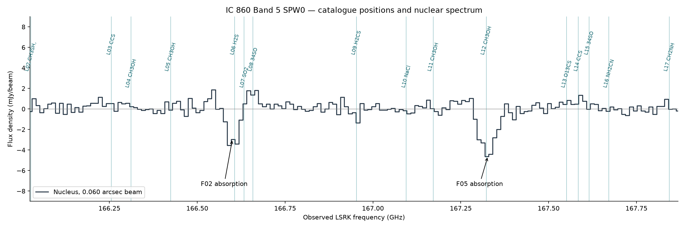

# con-line-search

An ALMA spectral-line workbench with an IC 860 Band 5 example. The interactive
workflow detects emission/absorption features with ESPADA/SoFiA, then queries
live Splatalogue for possible identifications and exports adopted feature maps.
Historical catalogue-guided scripts and results are retained for reproducibility.
This research prototype is not an excitation/radiative-transfer model.



## Example results

The pilot searched 18 windows in emission and absorption. Eight distinct
components were recovered; two absorption features pass the operational
robustness screen. One is consistent with H2S. The other has ambiguous
catalogue associations, including CH3OH and 30SiO. Feature detection does not
establish a molecular identification.

- [All prior positions and results](targets/ic860/alma/catalogue_spw0/qa/results.md)
- [Window spectra](targets/ic860/alma/catalogue_spw0/qa/targeted_windows.png)
- [Detailed method and limitations](targets/ic860/alma/catalogue_spw0/README.md)
- [Earlier four-SPW baseline analysis](targets/ic860/alma/espada_b5_all/README.md)

The +/-200 km/s windows cover 96% of SPW0; there is little search-bandwidth
reduction. S/N thresholds are robustness criteria, not calibrated false-alarm
probabilities. The published systemic redshift's exact reference frame remains
to be verified before interpreting small velocity offsets.

## Setup

Use Python 3.12 and a separate virtual environment:

```sh
python3.12 -m venv .venv
source .venv/bin/activate
python -m pip install -r requirements.txt
```

Install [SoFiA 2](https://gitlab.com/SoFiA-Admin/SoFiA-2) separately and put its
`sofia` executable on PATH. The pilot used SoFiA 2.7.1, commit
`a7434d9f91605cd738f2b13cd31b1450304fbc11`, with WCSLIB 8.2.2 and ESPADA 1.0.1.
ESPADA's SIP stage is disabled; no SIP installation is required for this workflow.

## Local data

Large FITS data, detector outputs, logs and environment files are excluded from
Git. The repository includes catalogue query snapshots, parameters, plots and
compact measurement results. The catalogue data remain third-party data from
[Splatalogue](https://splatalogue.online/#/basic); consult its upstream sources
and citation requirements when publishing results.

To use an existing CONs workspace without copying its cubes:

```sh
python scripts/link_ic860_data.py /path/to/CONs
```

That links the **historical cropped pilot** inputs. The current interface uses
separate full-field examples. Prepare them from the original Sabine Band 5 data:

```sh
python scripts/ic860_fullfield_prepare.py /path/to/CONs/targets/ic860/alma/Sabine/b5
```

This writes four ignored `targets/ic860/alma/fullfield/inputs/` FITS cubes,
retaining all 1024 × 1024 spatial pixels and convolving each channel to the same
0.060″ circular beam used in the pilot. Originals and historical 301 × 301
cutouts are untouched. The continuum map supplies the default nucleus position.
The preparation command refuses to overwrite existing outputs; `--spws 0` can
prepare one SPW at a time. Allow about 2.6 GB disk space for all four outputs.

To regenerate the archived pilot instead, place originals under
`targets/ic860/alma/Sabine/b5/` and run
`python scripts/ic860_espada_b5_all_prepare.py`.

## Reproduce the catalogue-guided pilot

From the repository root, after local data setup:

```sh
# Optional: refresh the public catalogue queries (otherwise use saved snapshots).
python scripts/ic860_spw0_catalogue_query.py
python scripts/ic860_spw0_catalogue_prepare.py
MPLBACKEND=Agg espada -c targets/ic860/alma/catalogue_spw0/config/espada.yaml
python scripts/ic860_spw0_catalogue_review.py
```

Preparation regenerates absolute paths for the current checkout; no originating
machine paths are required. The review reuses baseline measurement functions
from `scripts/ic860_espada_b5_rank.py` without running its full four-SPW analysis.
The copied snapshots retain their original scientific provenance; regenerated
results can differ if the live catalogue or software versions change.

## Development direction

Separate source redshift/frame metadata, catalogue selection, targeted detection,
blend hypotheses, joint multi-transition physical models, and injection/recovery
validation. Retain non-detections and quantify upper limits under stated linewidth
and excitation assumptions. Do not lower detection thresholds solely because a
catalogue predicts a transition.

No redistribution license for the project's original code has been selected yet.

## Local web interface

```sh
source .venv/bin/activate
python -m pip install -r requirements-ui.txt
# Put the compiled SoFiA executable on PATH, or set SOFIA_EXECUTABLE.
python -m streamlit run app.py
```

On macOS, after installing `requirements-ui.txt` in `.venv`, you can also
double-click **Start app.command**. It uses the project environment and, when
present, `.local-tools/sofia` (otherwise configure SoFiA as above). Keep its
terminal open while using the app. The address `http://127.0.0.1:8501` points to
your own computer: it works only while the server is running. After quitting the
server or restarting the computer, launch it again. Keep the environment and
SoFiA executable in persistent folders rather than a temporary directory.

Open http://127.0.0.1:8501. Cubes stay local. The interface now uses the real
ESPADA/SoFiA 3D finder first, followed by **live Splatalogue only** for identification.
Archived catalogue snapshots remain solely for reproducing the historical pilot.

1. Upload multiple FITS cubes, supply local paths, or select the IC 860 full-field examples.
2. Choose a circle, ellipse, rectangle or single pixel and inspect the extracted
   aperture-mean spectra and spatial noise controls. Default radius is one beam
   major-axis FWHM. Shared sky positions are projected onto each SPW separately.
   The example defaults to the continuum nucleus position. Step 2 has a 3× preview
   zoom; extraction and noise estimation always use the full loaded field. Controls
   are integer-pixel translations of the exact source stencil, avoiding boundary
   round-off changing their pixel counts. Set zoom to 1 to inspect the full field.
3. Run ESPADA on each cube, independently of redshift and molecular catalogues.
   Both emission and absorption are enabled by default. Components whose masks
   intersect the aperture are listed with short feature IDs. All are labelled
   on the spectrum; green features pass the additional aperture significance screen.
4. Fetch live Splatalogue matches for all detected features by default (uncheck the provisional
   option to restrict to significant ones). Every explicit matching request fetches fresh data. Network failure
   leaves detections available without substituting a saved catalogue. Changing
   catalogue filters or redshift does not invalidate detection or its significance.
   Queries now cover each loaded SPW's full frequency range, including SPWs with
   no detections. Species IDs, catalogue names, lower energies and the original
   frequency text are retained alongside the existing transition metadata.
5. Step 4 proposes the closest frequency match for every queried feature, within
   the adjustable default ±200 km/s tolerance. The overview table and spectrum
   label these **tentative** suggestions. Use **Review identifications one by one**
   to choose a transition or leave a feature unidentified, then **Confirm & next**.
   This panel has its own spectrum and does not depend on Step 3's inspector.
   Reviewed choices survive catalogue refreshes; a choice absent from the current
   filtered catalogue is kept and identified as such in the review panel.
   The **Evidence for this identification** panel shows the aperture centroid,
   its estimated error, the signed second-moment width, catalogue metadata and
   other transitions of the same catalogue species entry. Companion matches must
   lie inside another feature's interval and agree with the candidate's velocity
   offset within the adjustable default 50 km/s. Significant and provisional
   features are counted separately; multiple transitions in one feature count
   once. Opposite-sign features and uncertain centroids are shown separately.
   A companion spectrum viewer marks the predicted position at that velocity.
   These are frequency-compatibility checks, not identification probabilities.
6. Download a named solution as JSON or save it locally (ignored `solutions/`).
   Load a local solution or upload its JSON later. Solutions include assignments,
   review status, integration intervals, data fingerprints, aperture/detection
   settings, redshift and original live-query provenance. Only matching analyses
   are accepted; files may move to another path because identity is based on data
   and WCS, not filenames. Reusing chosen assignments is distinct from querying
   a catalogue: fresh alternatives always come from live Splatalogue.
7. Select features for maps in Step 5. It uses Step 4's assignments automatically,
   with no repeated transition selection. Unidentified maps use the observed
   centroid as the velocity-width reference, recording VREFGHZ instead of an
   assumed rest frequency/redshift. IDSTAT records TENTATIVE or REVIEWED.
   Previews default to 3× zoom; FITS maps retain the full spatial field.

Nearest frequency is not a physical identification or a probability ranking.
Matching now uses signed aperture moments inside the original ESPADA interval
when measurable. The original 3D centroid is retained for stable feature identity
and is an explicitly labelled fallback when aperture S/N is below 3, the line
sign disagrees, baseline coverage is incomplete, or the centroid is unstable.
Moment errors propagate whole control spectra (including channel correlations)
and constant/linear baseline differences. They are conditional estimates, not
calibrated confidence intervals, and omit systemic-redshift/frame uncertainty.
The width is a second-moment sigma within the detector interval, not a fitted
Gaussian FWHM or an instrumental-resolution-corrected width. Blending and interval
truncation can affect both measurements.

Companion evidence uses only successful current live queries and active catalogue
filters. Missing catalogue queries and failed detection runs are labelled
unavailable. Cross-SPW comparisons require linked apertures and identical known
spectral frames. No intensity ratios are compared, and a missing detection incurs
no penalty: an excitation/opacity model would be needed to predict detectability.
No fixed number of companion lines is required for a suggestion.

Provisional features remain provisional even after a molecule is assigned.
Solutions now also include aperture measurements and an evidence snapshot, while
remaining compatible with earlier version-1 solutions. Loading a solution does
not make its historical evidence current; fetch live matches again. Solutions do
not restore cubes or rerun detection for you; load the same data and settings,
run detection, then load the solution.

The ZIP export includes maps, interactive previews, feature table and provenance:
ESPADA parameter files/logs, aperture settings, live query time/results/filter audit,
adopted transitions, and the reusable identification solution. Edited map intervals do not recompute detection significance.

### Detection and significance

ESPADA runs SoFiA in separate emission and absorption modes. Defaults: 5σ voxel
threshold; unsmoothed and 3/5/9-channel spectral kernels; unsmoothed and one-beam
spatial kernels. Source linking retains the pilot's minimum sizes (5 pixels per
spatial axis, 2 channels, 50 voxels). Thus spatially tiny sources can be missed.
The continuum-subtracted checkbox defaults on; turn it off for SoFiA's linear
continuum subtraction. Cached runs can be reused when only the aperture changes.

Each overlapping component is independently assessed in the chosen aperture.
Two local baseline estimates (constant with five sideband channels per side,
linear with ten, after a two-channel gap) are applied to both source and control
spectra. Reported S/N is the smaller absolute result and must agree with the
ESPADA sign. Significant features require S/N≥8, complete sidebands, two adjacent
channels at ≥3σ, ≤30% baseline variation, and no spectral-edge/high-noise flag.
All other ESPADA components remain available as provisional features. Large
apertures can dilute compact lines below the significance threshold.

These thresholds are **not search-wide false-alarm probabilities**. No FDR,
completeness calibration, LTE modelling or abundance inference is claimed.
Blends can contaminate sidebands and alter centroids. Identification requires
checking other transitions and physically consistent excitation.

### Catalogue filtering

Default Extragalactic selection, Eu≤300 K, deuterated/trans species excluded,
multiple explicit rare-isotope substitutions excluded, log10(A/s⁻¹)≥−5 required.
Hot Cores and all screening choices are adjustable. Single rare-isotope
substitutions and excited vibrational/torsional lines are retained by default.
These label-based screens are incomplete and can exclude real weak transitions;
Einstein A is not a flux prediction. Download the filter audit to inspect exclusions.
Catalogue settings affect identification only.

### Supported data and verification

FITS axis order: RA, DEC, FREQ/VRAD/VOPT, optionally singleton Stokes. Velocity
axes require RESTFRQ. Brightness units: Jy/beam, mJy/beam, K, Jy/pixel. Variable
BEAMS are homogenized per cube, not across SPWs. This ESPADA integration requires
finite pixels; crop blank borders first. At least eight translated noise-control
apertures must fit in the field. No frame conversion, primary-beam correction,
spectral stacking or cross-SPW flux combination is performed.

```sh
python -m pytest -q
```

UI tests use synthetic cubes and controlled detector/catalogue results. Tests cover
sequential review, closest-match defaults, unidentified assignments, solution save/load,
context mismatch rejection, map export, zoom independence, stale aperture invalidation,
labels, spectral conversion and baselines. Real ESPADA/SoFiA is checked separately
against the local full-field IC 860 data.
